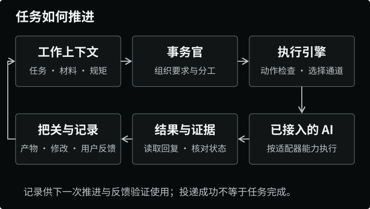
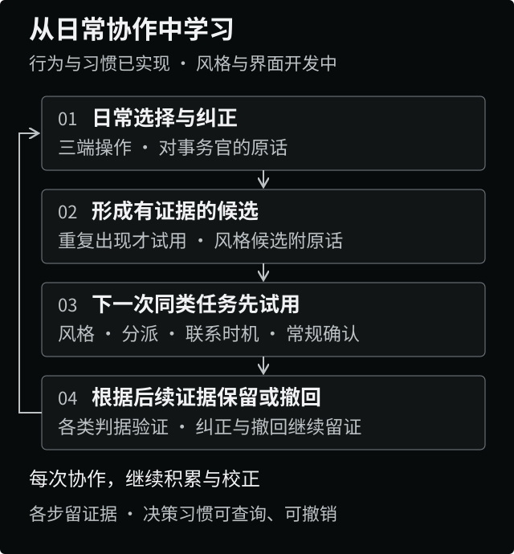
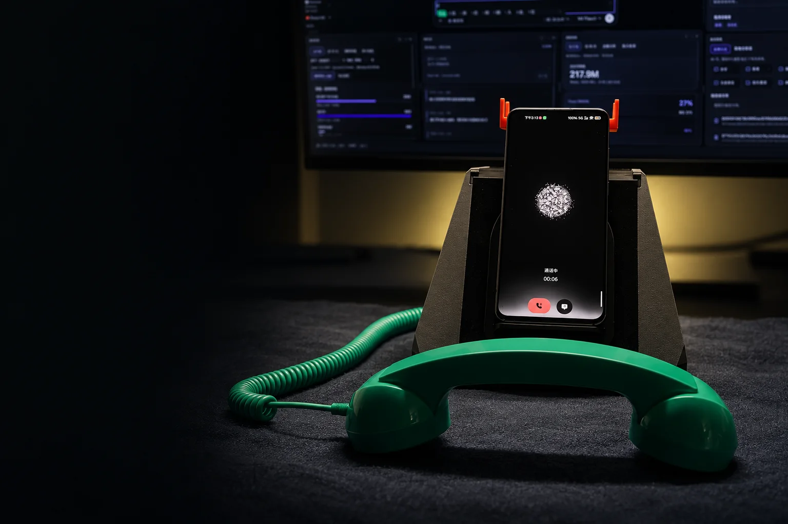
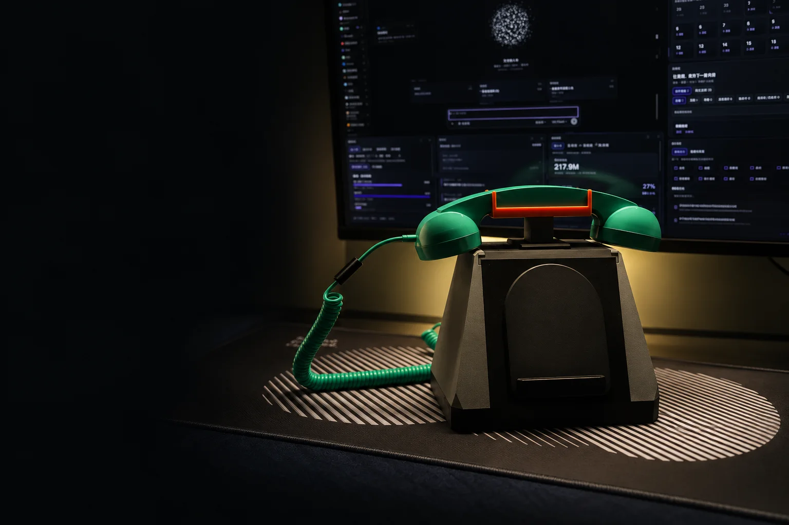
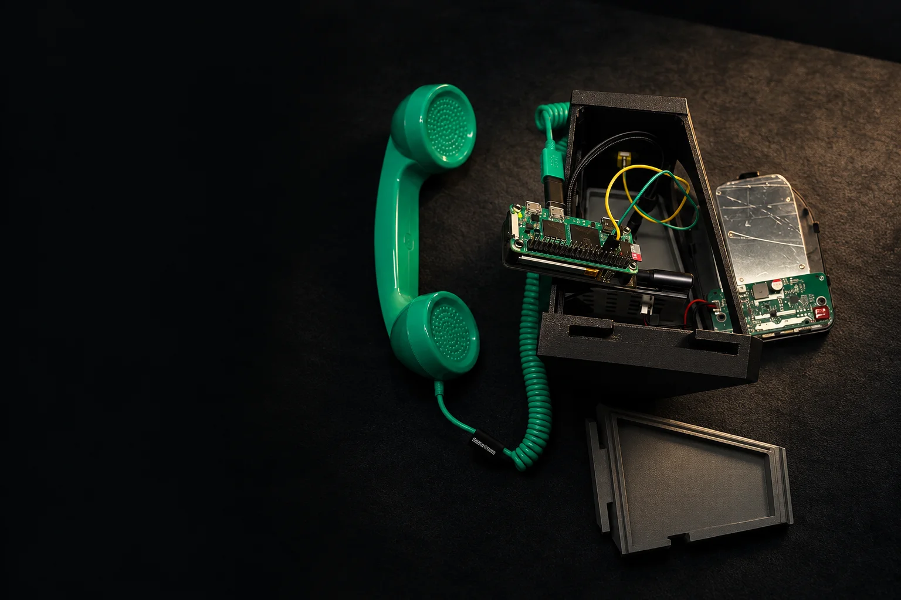

# 事务官座机

**Learning to share your work, over a long collaboration.**

AI has made writing, design and development faster, but a day still has the same number of hours. Running several AIs at once creates more possible output — and more work explaining context, switching between them, checking results and handling approvals.

We want that speed to turn into spare capacity for the person. **事务官座机** ("the desk phone") is a personal workbench built on **DeepSeek Harness** for independent workers. It connects material, discussion, AI delegation and deliverables around whatever you are working on, and gradually learns how to collaborate with you from the choices, edits and decisions you make day to day.

That kind of division of labour has to be earned. At first you set goals together, discuss the approach and check results; as its understanding proves reliable, the butler takes on more of the organising and follow-through. The aim is that, on familiar work you have delegated, it can carry a single instruction through execution, checking, feedback and delivery.

How much it does is up to you. Keep the parts you care about, take over at any point, change the approach or withdraw a delegation. The point of work done together is that the next round needs less repeated explaining and more of it can be handed over with confidence.

[Website & demo](https://www.aibooo.cn/) · [Downloads](#downloads) · [Implementation status](#implementation-status) · [Current implementation (Chinese)](docs/目前实现.md) · [Follow us](#follow-us) · [Installation & development](#installation-and-development) · [简体中文](README.md)


*Pilot / closed beta. Desktop: macOS on Apple Silicon; mobile: Android.*

## One Continuous Thread of Work

### Keeping Context Around the Work

A piece of work usually spans files, apps and several conversations. The butler organises material, intermediate outputs, revisions and review notes with topic cards and requirement cards; two desktop layouts — one for content work, one for product work — keep the relevant folders, application windows and boards within reach. When the next step starts, the task background, the current output and the rules that apply travel with it, so less has to be explained again.

The previous version is kept before an output is changed, and review notes are appended to the record so later execution can trace why an edit was made. Project news is searched by project and topic, with sources retained, and turned into a morning briefing or an audio podcast; suggested to-dos in it become tasks only after you confirm them. Material and decisions accumulate with the task and remain usable at handover.

[Tasks and revisions](workbench-plugin/src/server/deckRun.ts) · [Topic progression](workbench-plugin/src/server/topicRun.ts) · [Requirement progression](workbench-plugin/src/server/featureRun.ts) · [Project news](workbench-plugin/src/server/feed.ts)

### Clarifying the Work Through Discussion

Materials alone are not enough: the goal and the trade-offs still need to be clear. Executing against a vague goal tends to cost more in later corrections. You can talk things through with the butler on the computer, the phone or the handset; for decisions that involve other people, meeting mode extends the same thread before, during and after the meeting.

We treat meetings as part of the collaboration capability. It should help you prepare a purposeful discussion, carry the decisions forward, and improve the next meeting from the results. The full flow is still being built, in three connected stages:

- **Before: clarify the goal.** Identify the meeting type, participants and decision-maker, your own role, and what decision the meeting needs to produce. When the purpose is unclear, draft the questions that need answering first; then prepare likely questions, sourced data, phrasing suggestions and follow-up options.
- **During: support what you say and verify it.** The phone provides a recording entry point; highlighting key moments is planned. The computer is planned to offer sourced evidence and phrasing suggestions. When material is insufficient, it says so and you decide how to continue the conversation.
- **After: carry the decisions forward.** Conclusions, disagreements and to-dos are organised and, with your selection, fed into the work; execution results and post-meeting feedback then feed the next round of preparation. Anything intended for external communication is prepared and left for you to confirm.

This flow preserves the link between goals, approach and outcome so learning has something to work with: the next meeting tests whether preparation was stronger and decisions easier to act on. What is actually delivered at each stage is listed under [Implementation status](#implementation-status).

[Meeting handling](workbench-plugin/src/server/meeting.ts) · [Notes and to-dos](workbench-plugin/src/server/meetingText.ts) · [Phone meeting UI](butler-app/src/meeting/MeetingPage.tsx)

### Delegating to AI, Collecting Results and Feedback

Once a task is clear, the butler hands it to the connected AIs with its background and requirements. A single execution engine picks a channel — protocol, window, command line, API — based on task type and available capability, and records assignment, delivery and reply events.



For people to hand over work with confidence, the system has to own state verification and result checking. The engine distinguishes "confirmed delivered", "attempted but unconfirmed" and "not sent"; returned content is checked against the active rules, and your approvals, edits and rejections stay in the task record. The inbox, boards, daily report and day-end summary consolidate progress and pending confirmations, so you do not have to hunt through windows one by one.

Each AI's read, send, approve and stop capabilities are judged separately. Only retryable errors get a limited number of retries, and the engine switches channels only when the current one cannot perform the action; once an action rule blocks it, it stops. Progress and usage are computed from the records that can actually be obtained — where evidence is missing, the value stays unknown.

These records tell you where the work stands and give later learning its evidence: which delegation was changed, where an edit was needed, what result was accepted.

[Execution engine](workbench-plugin/src/server/engine/engine.ts) · [Adapter selection](workbench-plugin/src/server/engine/registry.ts) · [Task log](workbench-plugin/src/server/jobLog.ts) · [Rules and review](workbench-plugin/src/server/rules.ts)

## Learning How to Work Together

Input reaches beyond the text box: a choice, an edit, an answered call can all be signals; discussion and decisions add the reasons behind trade-offs, and later results test whether the understanding held. Learning has to show up in the next delegation: which work to take on, when to check with you, and how to contact and deliver.

The mechanism grows from explicit rules and review feedback into everyday interaction and collaboration strategy:

| What it learns | Effect on later work |
|---|---|
| **How to divide work** | Compare the recommendation with the final choice; when the same kind of work is repeatedly reassigned, try a better default delegation. |
| **When and how to contact you** | Adjust the morning briefing time and call windows from usage and answer records; use messages during hours when calls are inconvenient. |
| **Which repeated approvals can be reduced** | Form candidate practices from repeated confirmations of the same operation. Currently limited to two approval types: browser screenshots and operations on a specified repository. Habit changes, spending or quota decisions, external actions and steps only you can perform still require confirmation. |
| **How to phrase and deliver** | Work is expanding on extracting style requirements from your original wording, edit diffs and observation records. |
| **How to decide together** | Meeting learning will combine preparation, trade-offs and outcomes to adjust meeting method and how things are presented to different decision-makers. |

The butler also needs usable methods to begin with — asking what a meeting is for, organising material, checking a delivery — and then real results decide whether those methods suit you.



The mechanism runs as "record the facts → propose an evidenced candidate → try it on the next similar task → keep or withdraw". Patterns in delegation, contact and repeated approvals are counted in code; for style learning, a model extracts candidates backed by your original wording and code decides whether they enter a trial. Long-term rules you state explicitly can be recorded directly; practices inferred from behaviour need repeated evidence and later verification.

Each kind of habit uses its own trial criterion: default delegation compares the next recommendation with your actual choice; call windows check message substitutions and answer records; the morning briefing compares the configured prep time with when you start; approvals check later grants, corrections or revocations. Records that do not meet the criterion stay in trial. These criteria tune defaults — long-term effectiveness still needs continued evaluation.

Decision habits keep the evidence for trial, retention and withdrawal, managed through query and revoke interfaces; with a working directory configured they are written to an evolution log. A unified management UI is in development. A withdrawn habit is not re-learned automatically. Existing rules, preferences and defaults stay in the user layer alongside layouts, widgets, collectors and skills; the product itself is versioned, and widgets run from separate sources through restricted interfaces.

Reliable delegation is built from this evidence: discuss and correct together during the learning period, then let the butler take on more organising and follow-through as it becomes familiar. You can keep the work you care about or delegate a whole task within a clear scope. How much is shared varies by task and can be taken back at any time; learning cannot bypass operations that must ask first.

**Judge this system by counting the cost of explaining, checking, waiting and correcting.** We care whether repeated organising work decreases, whether the work you can confidently delegate grows, and whether you can spend your attention where you want it. If automation adds supervision and rework, the way we collaborate needs adjusting.

[Behaviour records](workbench-plugin/src/server/behaviorLog.ts) · [Decision habits](workbench-plugin/src/server/habits.ts) · [Preference validation](workbench-plugin/src/server/evolve.ts) · [Personal component interface (Chinese)](docs/自定义模块-接口.md)

## Step Away From the Screen

Once work is arranged, you should be able to leave the windows and do something else. The computer organises and executes, the phone lets you carry the material with you, and the handset offers conversation and a way to give feedback. When your input is needed, the system should contact you with the current context and a specific question, so you do not have to find and re-understand everything first.

| Entry point | What it does |
|---|---|
| **Computer workbench** | Organises tasks, connects AIs, stores material and records; can collapse into a particle orb when you are focusing. |
| **Android phone** | Read source conversations and attachments from supported providers, add requirements, reach news, podcasts, meetings and incoming calls. |
| **Physical desk phone** | Lift the handset to talk or answer, put it down to end. The phone provides the screen and ringtone; a Raspberry Pi handles handset audio and connects to the computer's call worker over LiveKit. |

When you add instructions to an existing conversation, the system locates the specific conversation first and asks for clarification if there are several candidates. You can choose to be called back after replying; other incoming calls follow rules and settings, and answering a call does not approve execution. Remote continuation goes through paired devices and a relay to the computer, which needs to be online.

[Source conversation lookup](workbench-plugin/src/server/sessionRelay.ts) · [Callback waiting](workbench-plugin/src/server/relayWatch.ts) · [Handset state machine](phone-bridge/phone_state.py)

### Handset, Phone and Dock

**Lifting the handset to talk**



**The dock and the workbench**



**Inside the dock**



## Implementation Status

As of **2026-10-30**, the project is in pilot / closed beta. The hosted workbench plugin hotfix is **0.4.192** (stable channel 0.4.142). The table separates what exists from what is being developed; cross-device behaviour depends on the corresponding configuration and environment. For a finer-grained picture and how to run it, see [Current implementation (Chinese)](docs/目前实现.md); for what it aims to become and the acceptance criteria, see [Goals (Chinese)](docs/目标.md); for the one-line path through the code, see [Map (Chinese)](docs/全景地图.md).

| Area | Current state |
|---|---|
| **Work context and AI delegation** | Work layouts, topic and requirement cards, output revisions, the unified execution engine, status and work records are implemented; actual read/write and execution scope varies by AI provider and environment. |
| **Multi-device continuation** | Source conversations and attachments on the phone, messages left for the butler, callbacks on request, handset calls, and project news / podcasts are implemented; they depend on the computer, devices and relevant services. |
| **Behaviour and decision learning** | Explicit rules, cross-task feedback and topic preferences, behaviour records across all three clients, default delegation / call windows / briefing time / repeated-approval habits, plus trial validation, the evolution log and query / revoke interfaces are implemented. |
| **Style learning and management UI** | Style learning from original wording, edit diffs and observation records, plus the "What it learned" page in the computer and phone settings (revocable) are implemented as of 0.4.109; long-term effectiveness needs continued use to verify. |
| **Refactor (from 2026-10)** | Four directions are agreed: move the core out of the shell, one event stream, one contract for actions, a shared ledger. The desk-phone service and ledger skeletons (`workbench-core/`), relay inbox and account groups have code and tests but are not live. Since 2026-10-29 work proceeds in four batches under "reliable execution loop": batch one (all entry points into the understanding hub, one execution record per delegation, a single dispatch path, mandatory verification and delivery on hand-back) landed in 0.4.189–192; the order and acceptance criteria for the remaining three batches are in [Goals (Chinese)](docs/目标.md). |
| **Full meeting flow** | Phone recording, transcription, notes and creating tasks from selected to-dos exist. Current work is on recording and post-meeting reliability; pre-meeting profiles and plans, in-meeting support on the computer, and meeting strategy learning are not yet implemented. |

The meeting chain still has to solve call interruptions, saving and uploading recordings after leaving the local network, and retry on failure; end-to-end verification on a real phone is not complete. The long-term effectiveness of the full learning chain also needs to be tested through continued use.

[Current implementation (Chinese)](docs/目前实现.md) · [Map (Chinese)](docs/全景地图.md)

### Runtime and Data

Work material and configuration are stored locally by default; models, search, speech and relay require their respective services, and relevant content is sent when they are called. Meeting recognition sends audio, and note-taking sends transcripts. Window integration needs the macOS Accessibility permission, and support varies by provider, client version and device.

The raw behaviour log stays on the machine only — it is not put into the memory repository and not pushed to a remote. It is read within a 90-day window, with expired files cleaned up monthly. It records operations from connected clients and what you say to the butler, not the chat bodies of the AIs; recognisable secret patterns are filtered before original wording is logged. Learning only adjusts the personal layer; it cannot modify the workbench itself or bypass boundaries that must ask first.

## Modules

| Directory | Responsibility and stack |
|---|---|
| `workbench-plugin/` | Workbench core: the butler, tasks, context, AI adapters, feedback rules and records. A DeepSeek Harness plugin — TypeScript, tsdown, vitest. |
| `workbench-app/` | macOS desktop shell hosting the workbench web UI, managing app windows and Accessibility operations. Swift. |
| `butler-app/` | Android client: conversation, continuation, news, meetings and calls. Capacitor, React, Vite. |
| `channel-worker/` | Real-time call worker on the computer: voice rooms, recognition, synthesis and the butler. |
| `phone-bridge/` | Raspberry Pi handset program: hook-switch detection, audio, LiveKit and network provisioning. Python. |
| `butler-server/` | Local avatar, voice and speech services. Live2D avatars are uploaded through its admin UI; neither the repository nor the installer ships a model. Express, `node:sqlite`, bound to loopback. |
| `display-client/` | Display layer: work status, Live2D / particle orb, music and lyrics. React, Vite. |
| `relay/` | Accounts, devices and remote relay; studio account groups and inbox (implemented, not deployed). |
| `workbench-core/` | Skeleton under refactor: desk-phone service (forwarding + read-only event stream) and ledger (`node:sqlite`). TypeScript, vitest. No process running yet. |
| `installer-app/`, `deploy/` | Installer, environment bootstrap, service templates and release scripts. |
| `docs/` | Three handover documents — goals, current implementation and map — plus source files read directly by code and tests (skills, prototypes, samples), installation / open-source notes, and README artwork. |

Each top-level project has its own build toolchain. The display layer and the Agent layer run in separate processes; the display renders and does not run models. The computer-side workbench service owns tasks and state, while the call worker connects the phone and handset over LiveKit.

## Installation and Development

The app is distributed as a macOS installer and an Android package, currently in a directed closed beta. Running it requires configuring models, speech and device connections; the physical desk phone additionally needs a Raspberry Pi, handset, hook-switch wiring and network.

### Downloads

Current source version **0.4.193**; desktop targets macOS / Apple Silicon, mobile targets Android. The table below lists the [v0.4.193 Release](https://github.com/Qzzz00/manboo-workbench/releases/tag/v0.4.193) assets. Both macOS installers were rebuilt with this source version; the Android APK is still the 0.4.192 build (not rebuilt in this release, merely attached to the same Release).

| Platform | Package | Size | Notes |
| --- | --- | --- | --- |
| macOS | [Manboo-workbench-0.4.193.dmg](https://github.com/Qzzz00/manboo-workbench/releases/download/v0.4.193/Manboo-workbench-0.4.193.dmg) | 182 MB | Full installer, includes the call worker |
| macOS | [Manboo-workbench-0.4.193-lite.dmg](https://github.com/Qzzz00/manboo-workbench/releases/download/v0.4.193/Manboo-workbench-0.4.193-lite.dmg) | 104 MB | Slim installer without the call worker; phone calls will not work on the installed machine |
| Android | [Manboo-app-0.4.192.apk](https://github.com/Qzzz00/manboo-workbench/releases/download/v0.4.193/Manboo-app-0.4.192.apk) | 66 MB | Still 0.4.192; debug-signed; install directly |

<details>
<summary>SHA-256 checksums</summary>

```text
8533977d216f3b9a416159b4d9ee5c8583d3a4857b635197cda78d0ce6ebbe35  Manboo-workbench-0.4.193.dmg
059eb0062153eb20215257f38d0697470b023e7a93806aae23f2a5d0fba37a3c  Manboo-workbench-0.4.193-lite.dmg
ddbc5bdf0fa60dc35469a43cf10693c52e104822fcb5bc6b7da20e480ce6e21d  Manboo-app-0.4.192.apk
```

</details>

The installers are ad-hoc signed and not notarised: on first launch, macOS requires **System Settings → Privacy & Security → Open Anyway**. The binaries are distributed as [v0.4.193 Release assets](https://github.com/Qzzz00/manboo-workbench/releases/tag/v0.4.193), not through Git (`dist/` is in `.gitignore`; GitHub blocks files larger than 100 MiB in a Git repository, while a Release asset may be up to 2 GiB with no limit on total release size or download bandwidth). Verify downloads against the SHA-256 checksums above.

Plugin development requires this repository and `deepseek-harness` (the DeepSeek Harness upstream, pinned to tag `dsh-v0.1.7-rc.2`, not upgraded) in the same parent directory. The plugin's `link:` dependencies point directly at upstream source without version constraints, and upstream packages' `main` / `types` point at build output in `lib/` (not committed), so you must install and build upstream first — checking out this repository alone is not enough to install those dependencies.

```text
workspace/
├── desktop-workbench/
└── deepseek-harness/
```

Environment: Node.js ≥ 24, pnpm ≥ 11; the mobile client additionally needs JDK 21 and the Android SDK; the shell and installer need Xcode. Prepare upstream, then build the plugin:

```bash
git clone https://github.com/deepseek-ai/deepseek-harness.git
cd deepseek-harness && git checkout dsh-v0.1.7-rc.2 && pnpm install && pnpm run build
cd ../desktop-workbench/workbench-plugin
pnpm install
pnpm --dir ../butler-server install   # needed by the plugin's installed-form test cases
pnpm test
pnpm typecheck
pnpm build
```

These commands run the plugin's tests, type check and build. Running the whole system also requires configuring DSH plugin loading, local services, speech services and device connections.

What this open-source repository builds is the **zero-server** variant: no server addresses are bundled. With one Mac, one Android phone and your own model and speech API keys, it works at home but not away from it. For how to install it and what it can do, see [Installation: zero server (Chinese)](docs/安装-零服务器.md); to use it away from home you need to run your own relay, see [Installation: self-hosted relay (Chinese)](docs/安装-自建中转.md).

Which external services it contacts and how to change or disable each is in [External connection list (Chinese)](docs/开源-对外连接清单-2026-10-21.md); which third-party code is included and under what licenses is in [Third-party dependency list (Chinese)](docs/开源-第三方依赖清单-2026-10-21.md) and the [channel-worker third-party notices](channel-worker/THIRD_PARTY_NOTICES.md).

Mobile commands are in [butler-app/package.json](butler-app/package.json), display-layer commands in [display-client/package.json](display-client/package.json), and the call worker requires Node.js 24 or newer, see [channel-worker/package.json](channel-worker/package.json). The native desktop shell is Swift and the handset program is Python; build and configure each in its own project. Read the [development guidelines (Chinese)](AGENTS.md) before contributing code.

### Multi-user collaboration (off by default)

This repository still contains a studio-oriented multi-user collaboration stack: workspaces and member invites, cross-machine inbox, object directory, channels, scheduled dispatch, WeCom bindings and more. **It is switched off by default in the open-source build**: the local service mounts no `/collab/*` routes, does not merge collaboration data into `/state`, and starts no cross-machine polling or scheduled dispatch; `relay/` creates none of the 15 collaboration tables and mounts none of the `/v1/*` collaboration routes; neither the desktop nor the phone UI shows a collaboration entry.

There is one switch, read once at startup (restart the workbench and the relay after changing it):

| Where | Values | Notes |
| --- | --- | --- |
| Environment variable `WORKBENCH_COLLAB_ENABLED` | `1` / `true` / `on` enables, `0` / `false` / `off` disables | Highest priority; the local workbench and `relay/` read the same variable |
| `collab_enabled` in `~/.dsh/workbench/app.json` | boolean | Affects the local workbench only; the relay is a separate process and does not read this file |
| Neither is set | **Off** | Intentional: the out-of-the-box build does not wire this feature up |

To enable it fully, both sides must opt in: set the environment variable or `"collab_enabled": true` on the Mac, and set `WORKBENCH_COLLAB_ENABLED=1` on the relay. The server publishes the effective value as `/state.collab_enabled`, so the desktop and phone UIs follow it without a rebuild.

> **This switch disables the feature, not the source code.** The implementation files are still in this repository and readable by anyone who clones it. If the goal is to keep the implementation itself private, the related files must be removed from the source tree, a history-free commit rebuilt, and the DMG / APK repackaged — the installers in `dist/` carry that front-end code too, since the switch disables behaviour, not files.

## Follow Us

Scan to follow our social accounts or join the WeChat user group:

| Douyin (抖音) | WeChat user group (微信用户群) | Xiaohongshu / RED (小红书) | Bilibili (B站) |
| :---: | :---: | :---: | :---: |
|  |  |  |  |

Group QR codes are refreshed periodically; if one has expired, check the [website](https://www.aibooo.cn/) for the current one.

## License

This project is licensed under the [Apache License 2.0](LICENSE). You may use, modify and distribute the code in this repository under its terms.

Third-party components remain under their own licenses; see the [third-party dependency list (Chinese)](docs/开源-第三方依赖清单-2026-10-21.md) and the [channel-worker third-party notices](channel-worker/THIRD_PARTY_NOTICES.md). The documents in [docs/licensing (Chinese)](docs/licensing/README.md) are early, never-effective license drafts kept as historical records; they impose no conditions on this project.
