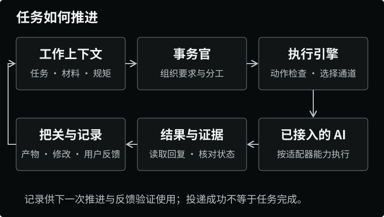
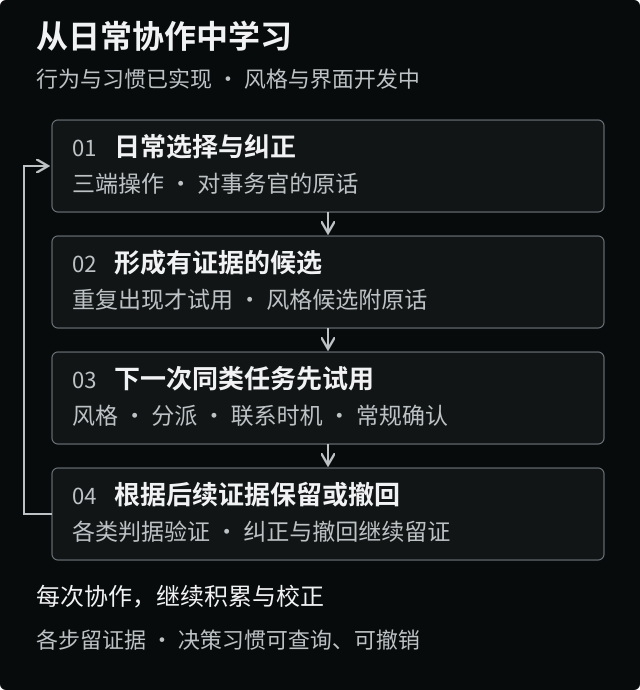
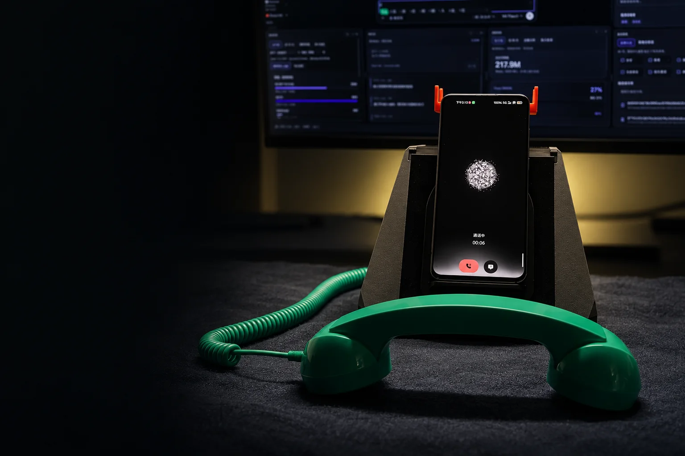
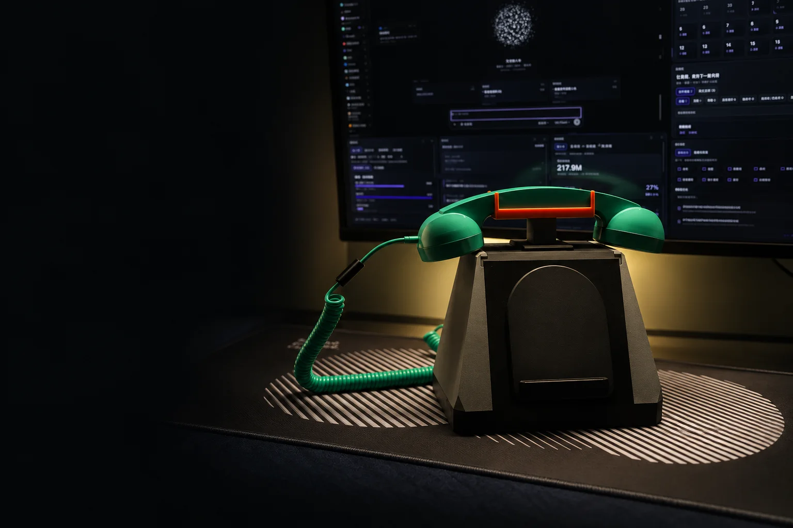

# 事务官座机

**在长期协作中，学会分担你的工作。**

AI 正在加快写作、设计和开发，人的一天却没有变长。几家 AI 同时工作，带来了更多产出的可能，也带来了更多交代背景、切换上下文、检查结果和处理确认的劳动。

我们希望 AI 的效率真正转化为人的余力。事务官座机是一套基于 **DeepSeek Harness**、面向独立工作者的个人工作台，围绕正在做的事连接材料、讨论、AI 分工和交付结果，并从日常的选择、修改与决策中，逐步学习如何与人配合。

这种分工需要经过磨合。起初，一起明确目标、讨论做法、检查结果；随着理解得到验证，事务官逐步承担更多组织与推进工作。我们的目标是在熟悉且得到委托的事务上，让它接下一次交代，推进到执行、检查、处理反馈和交付。

参与程度由人决定。你可以把精力放在自己重视的部分，也可以随时接手、改变做法或收回委托。我们希望共同做过的每一件事，都让下一次协作少一些重复交代，多一些可以放心交出的工作。

[官网与演示](https://www.aibooo.cn/) · [下载](#下载) · [实现状态](#实现状态) · [目前实现](docs/目前实现.md) · [关注我们](#关注我们) · [开发入口](#安装与开发) · [English](README.en.md)


*试点 / 内测中。桌面端面向 macOS / Apple Silicon，手机端为 Android。*

## 把工作接成一个连续的过程

### 围绕事情保存上下文

一次工作通常跨过文件、应用和多段对话。事务官用选题卡、需求卡组织材料、阶段产物、修订与验收意见，内容和产品两套桌面布局把相关目录、常用应用窗口与看板放在手边。推进下一步时，任务背景、当前产物和适用的工作规则一起带过去，减少重新交代。

产物修改前保留上一版，验收意见追加到记录中，使后续执行可以查到修改依据。项目资讯按项目和关注点搜索，保留出处，整理为早报或语音播客；其中的待办建议，经用户确认后成为事项。材料与决定随任务积累，交接时可以继续使用。

[任务与修订](workbench-plugin/src/server/deckRun.ts) · [选题推进](workbench-plugin/src/server/topicRun.ts) · [需求推进](workbench-plugin/src/server/featureRun.ts) · [项目资讯](workbench-plugin/src/server/feed.ts)

### 在讨论中认清要做的事

有了材料，还要弄清目标与取舍。目标含糊时直接执行，往往会增加后续纠正的成本。用户可以在电脑、手机或听筒里与事务官商量；对于需要与其他人共同决定的事，会议模式把同一条思路延伸到会前、会中和会后。

我们把会议看作协作能力的一部分。它需要帮助人准备一场有目的的讨论，把定下的事接着办，再从结果里改进下一场的准备。会议全流程正在建设，按三个环节衔接：

- **会前认清目标。** 明确会议类型、参与者与决策人、用户的角色，以及这场会要形成什么决定。目的尚不清楚时，先拟出需要澄清的问题；再准备可能被问到的事、带出处的数据、表达建议与后续补充方案。
- **会中支持表达与查证。** 手机端提供录音入口，重点标记功能正在规划；电脑端规划提供有出处的依据和表达建议。资料不足时明确说明，由用户决定如何继续沟通。
- **会后接续行动。** 整理结论、分歧和待办，经用户选择接入工作；进一步把执行结果与会后反馈带回下一场准备。涉及对外沟通的内容，准备好后交由用户确认。

这条流程为学习保留目标、做法与结果之间的关系，用下一场会议检验准备是否更充分、决定是否更容易落实。各环节的完成范围见[实现状态](#实现状态)。

[会议处理](workbench-plugin/src/server/meeting.ts) · [纪要与待办](workbench-plugin/src/server/meetingText.ts) · [手机会议界面](butler-app/src/meeting/MeetingPage.tsx)

### 组织 AI 分工，收回结果与反馈

当一件事已经明确，事务官带着它的背景与要求，安排已接入的 AI 推进。统一执行引擎根据任务类型和当前能力选择协议、窗口、命令行、API 等通道，并记录指派、投递、回复等事件。



要让人逐步放心交出工作，系统需要承担状态核对与结果检查。执行引擎区分“已确认送达”“尝试过但未确认”和“没有送出”；交回的内容按已接入的规则检查，用户的通过、修改与退回意见继续留在任务记录中。收件箱、看板、日报与日结汇总进度和待确认事项，减少逐个窗口查找的劳动。

各家 AI 的读取、发送、审批和停止能力分别判断。执行中只对可重试错误有限重试，通道不支持该动作时才换路；动作规则拦下后就停下。进度与用量依据能取得的记录计算，缺少证据的地方保留为未知。

这些记录既让人知道工作到了哪里，也为后续学习提供依据：哪次分工被改变、哪里需要修改、什么结果被接受。

[执行引擎](workbench-plugin/src/server/engine/engine.ts) · [适配器选择](workbench-plugin/src/server/engine/registry.ts) · [任务日志](workbench-plugin/src/server/jobLog.ts) · [规则与验收](workbench-plugin/src/server/rules.ts)

## 从做过的事里，学会怎样配合

输入延伸到输入框之外：一次选择、一处修改、一次接听都可能提供线索；讨论与决策补充取舍的理由，后续结果用来检验理解。学习要落实到下一次分工：哪些工作适合接手、何时需要商量、怎样联系和交付更合适。

这套机制从明确规则与验收反馈，扩展到日常交互和协作策略：

| 学习的内容 | 对后续工作的影响 |
|---|---|
| **如何分工** | 比较推荐与最终选择，同类工作反复被改派时，试用更合适的默认分工。 |
| **何时、怎样联系用户** | 根据开始使用与接听记录，调整早报时刻和来电时段；不便接听的时段改用消息。 |
| **哪些重复审批可以减少** | 从同类操作的重复确认中形成候选做法。目前限于浏览器截图与指定仓库操作两类审批；涉及习惯变更、费用或额度决策、对外行为、需本人完成的操作，仍须确认。 |
| **怎样表达和交付** | 正在扩展从原话、改稿差异与观察记录中提取风格要求的能力。 |
| **怎样共同作出决定** | 会议学习将结合准备、取舍与结果，调整会议方法和面向不同决策人的表达方式。 |

事务官也需要先带着可用的方法参与协作，例如问清会议目的、组织材料和核对交付；再由真实结果检验这些方法是否适合你。



机制按“记录事实 → 提出有证据的候选 → 下一次同类工作试用 → 保留或撤回”推进。分派、联系和重复审批的规律由代码计数；风格学习设计由模型提取附带原话证据的候选，再由代码判断是否进入试用。明确交代的长期规则可以直接记下，从行为推断的做法则要经过重复证据与后续检验。

每类习惯使用对应试用判据：默认分派比较下一次推荐与实际选择，来电时段检查消息替代和接听记录，早报比较设定的准备时刻与开始使用时刻，审批检查后续通过、纠正或撤销。没有满足判据的记录时继续试用；这些判据用于调整默认做法，长期效果仍需持续评估。

决策习惯保留试用、保留与撤回的证据，通过查询和撤销接口管理；配置工作目录后写入进化日志。统一管理界面正在开发。撤掉的同一条不再自动学回来，已有的规则、偏好和默认值与布局、小组件、采集器、技能一起保留在用户层；产品本体按版本维护，小组件通过独立来源和受限接口运行。

可靠的分工由这些证据逐步建立：学习期里共同讨论与纠正，熟悉后增加事务官承担的组织与推进。用户可以保留自己重视的工作，也可以在明确范围内委托完整事务。分担程度因事而异，随时能够收回；学习不能绕过必须确认的操作边界。

**评价这套系统，要把交代、检查、等待与纠正的成本一起计算。** 我们关注重复组织劳动是否减少、可放心委托的工作是否增加，以及用户能否把精力放在自己重视的部分。如果自动化增加了监督与返工负担，就需要调整协作方式。

[行为记录](workbench-plugin/src/server/behaviorLog.ts) · [决策习惯](workbench-plugin/src/server/habits.ts) · [偏好验证](workbench-plugin/src/server/evolve.ts) · [个人组件接口](docs/自定义模块-接口.md)

## 人可以离开屏幕，协作继续

安排完工作后，人应当能够离开窗口继续其他事情。电脑负责组织与执行，手机让用户带着材料接续，听筒提供交谈与接回反馈的入口。需要用户参与时，系统应带着当前背景和具体问题联系，减少重新查找与理解的成本。

| 入口 | 负责什么 |
|---|---|
| **电脑工作台** | 组织任务、接入 AI、保存材料与记录；专注时可收起为粒子球。 |
| **Android 手机** | 查看支持来源的原会话与附件、补充要求，访问资讯、播客、会议和来电。 |
| **实体座机** | 提起听筒交谈或接听，放下结束；手机提供屏幕与铃声，树莓派负责听筒录放音，通过 LiveKit 与电脑通话进程连接。 |

向原会话补充指令时，系统先定位具体会话，有多个候选时先澄清。用户可以选择回复后回电，其他来电按规则与设置触发；接听本身不代表批准执行。远程接续通过已配对设备和中转连接电脑，需要电脑在线。

[原会话定位](workbench-plugin/src/server/sessionRelay.ts) · [回电等待](workbench-plugin/src/server/relayWatch.ts) · [听筒状态机](phone-bridge/phone_state.py)

### 听筒、手机与底座

**提起听筒通话**



**底座与工作台**



**内部结构**


## 实现状态

截至 **2026-10-30**，项目处于试点 / 内测阶段，线上工作台插件热修版本为 **0.4.192**（稳定通道 0.4.142）。以下区分现有实现与开发方向；跨设备运行效果取决于相应配置和环境。更细的现状与怎么跑起来见 [目前实现](docs/目前实现.md)，要做成什么与验收标准见 [目标](docs/目标.md)，一句话在代码里怎么走见 [全景地图](docs/全景地图.md)。

| 环节 | 当前状态 |
|---|---|
| **工作上下文与 AI 分工** | 工作布局、选题与需求卡、产物修订、统一执行引擎、状态与工作记录已有实现；实际读写和执行范围随 AI 来源与环境而异。 |
| **多端接续** | 手机原会话与附件、捎话、按需回电、实体听筒通话，以及项目资讯 / 播客已有实现；依赖电脑、设备与相应服务。 |
| **行为与决策学习** | 明确规则、跨事项反馈与选题偏好、三端行为记录、默认分派 / 来电时段 / 早报时刻 / 重复审批习惯，以及试用验证、进化日志和查询 / 撤销接口已有实现。 |
| **风格学习与管理界面** | 原话、改稿与观察记录的风格学习，以及电脑与手机设置里的“它学到了什么”页（可撤回）已有实现（0.4.109 起）；长期效果需要持续使用检验。 |
| **重构（2026-10 起）** | 已拍板「核心出壳、一条事件流、一份手的契约、可共享的账」四个方向；座机服务与账的骨架（`workbench-core/`）、中转收件箱与账号组已有代码与测试，尚未上线。2026-10-29 起按「可靠执行闭环」四批推进：第一批（所有入口进理解中枢、一件委托一张执行记录、派发口归一、交回必核与交付）已合入 0.4.189–192；后三批的顺序与验收见 [目标](docs/目标.md)。 |
| **会议全流程** | 已有手机录音、转写、纪要与选中待办建事项。当前完善录音与会后处理的可靠性；会前画像与预案、电脑端会中支援、会议协作策略学习尚未实现。 |

当前会议链路仍需解决来电中断、离开局域网后的录音保存与上传、失败重试，尚未完成真手机端到端验收。完整学习链路的长期效果，也需要在持续使用中检验。

[目前实现](docs/目前实现.md) · [全景地图](docs/全景地图.md)

### 运行与数据

工作资料和配置以本机保存为基础；模型、搜索、语音与中转需要相应服务，调用时会发送相关内容。会议识别需要发送音频，纪要整理需要发送转写文字。窗口接入需要 macOS 辅助功能授权，各来源、客户端版本和设备的支持程度不同。

原始行为账只保存在本机，不进记忆仓库、不推远端；按 90 天范围读取，并按月清理过期文件。它记录已接入的操作和你对事务官说的话，不收各家 AI 的聊天正文，原话入账前过滤可识别的密钥形式。学习只调整个人层，不能修改工作台本体或绕过必须询问的边界。

## 模块分工

| 目录 | 职责与技术栈 |
|---|---|
| `workbench-plugin/` | 工作台核心：事务官、任务、上下文、AI 适配器、反馈规则与记录。DeepSeek Harness 插件，TypeScript、tsdown、vitest。 |
| `workbench-app/` | macOS 桌面壳，承载工作台网页、管理应用窗口与辅助功能操作。Swift。 |
| `butler-app/` | Android 手机端，对话、会话接续、资讯、会议与来电。Capacitor、React、Vite。 |
| `channel-worker/` | 电脑端实时通话进程，连接语音房间、识别、合成与事务官。 |
| `phone-bridge/` | 树莓派听筒程序，提挂机检测、录放音、LiveKit 与配网。Python。 |
| `butler-server/` | 本机形象、音色与语音等服务；Live2D 形象靠在它的配置后台上传，仓库与安装包不带模型。Express、`node:sqlite`，监听回环地址。 |
| `display-client/` | 展示层：工作状态、Live2D / 粒子球、音乐与歌词。React、Vite。 |
| `relay/` | 账号、设备与远程中转；工作室账号组与收件箱（已实现，未部署）。 |
| `workbench-core/` | 重构中的座机服务骨架（转发 + 只读事件流）与账的骨架（`node:sqlite`）。TypeScript、vitest。尚无进程在跑。 |
| `installer-app/`、`deploy/` | 安装器、环境引导、服务模板与发版脚本。 |
| `docs/` | 给接手者的三份：目标、目前实现、全景地图；另有代码与测试直接读取的源文件（技能、原型、样例）、安装与开源说明、README 配图。 |

各顶层工程使用独立构建工具链。展示层与 Agent 层分进程；展示台负责渲染，不运行模型。电脑端工作台服务承接任务与状态，通话进程通过 LiveKit 连接手机和听筒。

## 安装与开发

应用通过 macOS 安装包与 Android 安装包分发，目前处于定向内测阶段。运行需要完成模型、语音与设备连接配置；实体座机另需树莓派、听筒、提挂机接线与网络。

### 下载

当前版本 **0.4.192**：桌面端面向 macOS / Apple Silicon，手机端为 Android。

| 平台 | 安装包 | 大小 | 说明 |
| --- | --- | --- | --- |
| macOS | [Manboo-workbench-0.4.192.dmg](dist/Manboo-workbench-0.4.192.dmg) | 157 MB | 完整包，含通话组件 |
| macOS | [Manboo-workbench-0.4.192-lite.dmg](dist/Manboo-workbench-0.4.192-lite.dmg) | 104 MB | 不含通话组件，装出来的机器手机通话不可用 |
| Android | [Manboo-app-0.4.192.apk](dist/Manboo-app-0.4.192.apk) | 66 MB | debug 签名，可直接安装 |

<details>
<summary>SHA-256 校验值</summary>

```text
c74a1216385fa71ca1ff8c9acf986e519715830c6bbad19a5e6371451716036a  Manboo-workbench-0.4.192.dmg
472be85eee09728daa0b24a2bedaebf3857e4d411616fae7e2e334a550832535  Manboo-workbench-0.4.192-lite.dmg
ddbc5bdf0fa60dc35469a43cf10693c52e104822fcb5bc6b7da20e480ce6e21d  Manboo-app-0.4.192.apk
```

</details>

安装包为 ad-hoc 签名、未公证：macOS 首次打开需到「系统设置 → 隐私与安全性 → 仍要打开」。这些二进制文件不随 Git 仓库分发（`dist/` 在 `.gitignore` 中；GitHub 对仓库内单个文件限制 100 MiB，安装包不能进 Git 历史）。GitHub Release 附件单文件上限为 2 GiB，且不限 Release 总大小与下载带宽，因此公开发布时请把它们作为 Release 附件上传，并把上表链接换成对应的 Releases 下载地址。

插件开发需要将本仓库与 `deepseek-harness`（DeepSeek Harness 上游，锁在标签 `dsh-v0.1.7-rc.2`，不跟随升级）放在同一父目录。插件的 `link:` 依赖直接引用上游源码，不带版本约束；上游各包的 `main` / `types` 指向构建产物 `lib/`（不入库），所以必须先在上游里安装并构建，仅检出本仓库不足以安装这些依赖。

```text
workspace/
├── desktop-workbench/
└── deepseek-harness/
```

环境：Node.js ≥ 24、pnpm ≥ 11；手机端另需 JDK 21 与 Android SDK；壳与安装器需 Xcode。先准备上游，再构建插件：

```bash
git clone https://github.com/deepseek-ai/deepseek-harness.git
cd deepseek-harness && git checkout dsh-v0.1.7-rc.2 && pnpm install && pnpm run build
cd ../desktop-workbench/workbench-plugin
pnpm install
pnpm --dir ../butler-server install   # 插件里的装机形态用例要用到它的依赖
pnpm test
pnpm typecheck
pnpm build
```

上述命令完成插件的测试、类型检查与构建。运行整套系统还需配置 DSH 插件加载、本机服务、语音服务及设备连接。

开源仓库构建出来的是「零服务器」那一档:不带任何服务器地址,一台 Mac、一部安卓手机加上自己申请的模型与语音钥匙,在家里就能用,出门不能用。
怎么装、能做什么见 [安装-零服务器](docs/安装-零服务器.md);要出门也能用得自己架中转,见 [安装-自建中转](docs/安装-自建中转.md)。

它连了哪些外部服务、各自怎么改或关,见 [对外连接清单](docs/开源-对外连接清单-2026-10-21.md);带了哪些第三方代码、按什么许可,见 [第三方依赖清单](docs/开源-第三方依赖清单-2026-10-21.md) 与 [通话组件第三方声明](channel-worker/THIRD_PARTY_NOTICES.md)。

手机端命令见 [butler-app/package.json](butler-app/package.json)，展示层命令见 [display-client/package.json](display-client/package.json)，通话进程要求 Node.js 24 或更新版本，见 [channel-worker/package.json](channel-worker/package.json)。原生桌面壳使用 Swift，听筒程序使用 Python；分别在对应工程中构建和配置。参与代码修改前请阅读 [开发规范](AGENTS.md)。

### 多人协作区（默认关闭）

仓库里还留着一套面向工作室的多人协作代码：工作室与成员邀请、跨机收件箱、对象目录、频道、定时派活、企微绑定等。**开源版默认整块关闭**：本机不挂 `/collab/*` 路由、不合并协作区快照、不起跨机长轮询与定时派活；`relay/` 不建那 15 张表、不挂 `/v1/*` 协作路由；桌面与手机的协作区入口都不显示。

开关只有一个，启动时读一次（改完要重启工作台与中转）：

| 位置 | 取值 | 说明 |
| --- | --- | --- |
| 环境变量 `WORKBENCH_COLLAB_ENABLED` | `1` / `true` / `on` 开，`0` / `false` / `off` 关 | 优先级最高；本机工作台与 `relay/` 中转读同一个变量 |
| `~/.dsh/workbench/app.json` 的 `collab_enabled` | 布尔值 | 只影响本机工作台；relay 是独立进程，不读这个文件 |
| 两处都没配 | **关** | 有意如此：开箱不接这一整块 |

要完整开启，两边都得开：本机设环境变量或在 `app.json` 写 `"collab_enabled": true`，中转侧设 `WORKBENCH_COLLAB_ENABLED=1`。服务端把当前值放进 `/state.collab_enabled`，桌面与手机据此收起或显示入口，不用重新打包。

> **这个开关关的是功能，不是源码。** 协作区的实现文件仍在本仓库里，克隆即可读到；若目标是连实现都不公开，需要在发布前从源码仓剔除相关文件、重建一个没有历史记录的提交，并重新打包 DMG / APK —— 当前 `dist/` 里的安装包是加开关之前构建的，仍含这部分前端代码。

## 关注我们

扫码关注自媒体账号，或加入微信用户群：

| 抖音 | 微信用户群 | 小红书 | B站 |
| :---: | :---: | :---: | :---: |
|  |  |  |  |

群二维码会定期更新，若已失效请以[官网](https://www.aibooo.cn/)公布的信息为准。

## 许可证

本项目采用 [Apache License 2.0](LICENSE)。你可以按该许可的条款使用、修改和分发本仓库代码。

第三方组件仍适用各自的许可证，见 [第三方依赖清单](docs/开源-第三方依赖清单-2026-10-21.md) 与 [通话组件第三方声明](channel-worker/THIRD_PARTY_NOTICES.md)。[docs/licensing](docs/licensing/README.md) 中是早期未生效的许可草案，仅作历史档案，不构成对本项目的授权条件。
