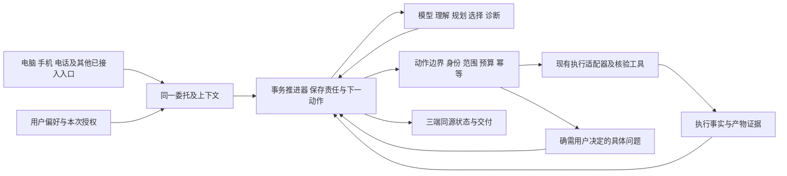

# 目标 —— 这个产品要做成什么（给接手的研发，2026-10-30）

> 本仓库 `docs/` 留给接手者三份文档：本文讲**要做成什么、按什么标准算做成、接下来按什么顺序做**；[目前实现](目前实现.md) 讲做到哪了、怎么跑起来；[全景地图](全景地图.md) 讲一句话在代码里怎么走、各目录管什么。先读 [README](../README.md)，再读这三份。

## 一、产品是什么，给谁

- 项目名「事务官座机」。一句话：桌上多一部电话，少守着几个 AI。
- 给用 AI 做内容、做产品的独立工作者，包括不会写代码的半专业个体。普通用户按双击安装包用，不以命令行为入口。
- 要解决的问题：AI 执行越快，人的交代、检查、等待、纠正越成为瓶颈；人的注意力、记忆与判断节奏跟不上 AI 的产出。评价效果要把交代、检查、等待与纠正的成本一起算。
- 做法：从一张按工作安排的桌面开始，把选题、需求、材料、常用工具放在手边。一个「事务官」带着工作背景安排已接入的 AI 分工、跟进结果、按证据核验、把经过确认的做法留下来。参与程度由人决定：可以保留重视的工作，也可以委托完整事务，随时接手或收回。
- 三个入口：电脑组织工作、保存记录；手机看材料、听播客、接续原对话，也负责座机的显示与铃声；实体听筒由树莓派接入 LiveKit 房间，提起交谈、放下结束。远程接续需要电脑在线。
- 四个做法：先把工作接起来；围绕项目主动递来资讯和待办建议；一起做，也用听筒商量；把经过确认和验证的做法留下来。

## 二、边界：做到哪为止

- 不扩成通用 AI 助手。范围是具体工作中的组织与接续。
- 不写「你只做判断，其余交给它」的包办承诺。分担程度按具体事务、实际协作证据和用户委托逐步变化：学习期共同讨论与纠正，之后共同推进，再在熟悉的事情上自主闭环。
- 事实与数据：进度、额度、规则验证按记录和程序算，取不到就缺席，不编；模型负责需要理解和生成的部分。资料与配置保存在本机，但调用模型、语音、搜索、中转时会发送相关内容，不能写「所有数据永不上传」或「完全离线」。
- 用户层与本体分开：用户自己的布局、小组件、采集器、技能与偏好和产品本体分开维护，不随本体发版上传或合并；本体只经加载口装它们；学习只改用户层，不改本体。
- 积累做法有边界：用户明确交代的长期规矩直接记；不同事项重复出现的同类反馈可成为试用规矩，按后续把关保留或撤回。不能写成「全面理解用户」。重复审批学习只适用于已支持的两类操作，保留必须询问的边界。
- 五项不可改（任何自我迭代 / 提议流程不得触及）：AI 悬浮窗、回滚机制、记忆读写规则、日结功能本身、澄清环节。
- 四类必须问本人：花钱、对外发布 / 推公网、本人账号与设备配对、习惯与范围的取舍。其余技术事实由事务官自己查、自己定，不把普通技术协调推给用户。

## 三、机制目标：一件委托有人负责到底

截至 2026-10-29 诊断出的核心问题是：一次委托没有一个持续负责到底的执行机制。理解、派发、观察、核验、审批各自判断、各自落状态，遇到不确定就把责任转给用户；另一些路径留下状态但没有后续动作。多加一处检查，就可能多出一个没有出口的停点。方向如下，第一批已经落地（见 [目前实现](目前实现.md)）。

### 1 模型做判断，程序做可靠执行

事务官不是「把一句话翻成命令」的分类器。它应持续看到目标、验收要求、授权范围、计划版本、已完成部分、当前执行、失败原因、可用能力和预算，据此决定补材料、分工、等待、换手、重试、核验、修正计划或提出必要的问题。不为每一句自然语言加词表，不把每种故障写成问人。

程序保留实际能力、执行参数、权限与事实校验：模型不能自报完成、伪造授权、替程序猜进程是否结束。简单任务一次判断直接执行，复杂任务才展开计划。模型暂时不可用时，已启动执行的观察、停止、记账、重启恢复继续工作；需要新判断的任务标明「等待判断恢复」，不伪装失败，也不自动放宽权限。

### 2 四种对象，各一个写入方

「一本账」指事实权威统一，不是把所有概念塞进一个 status。

| 对象 | 负责的问题 | 必须分开的事实 |
|---|---|---|
| 委托 Task | 用户要什么、范围到哪、当前由谁推进 | 计划 / 验收版本、最终交付、取消或重开 |
| 一次执行 Attempt | 哪只手在哪个工作区执行这一版计划 | 准备、已送出、已接单、运行、停止中、退出、结果不明 |
| 核验 Verification | 哪一份产物满足哪些条件 | 产物版本、条件版本、证据、通过 / 未过 / 证据不足 |
| 用户决定 Decision | 真正还缺用户决定什么 | 具体动作、对象与版本、已有授权、答复状态 |

每个事实只有一个权威写入方；任务状态、执行计数、窗口角标、来电、容量和中枢上下文消费同一份派生结果。进程结束不等于任务完成，产物通过不等于已发布，用户取消不等于对端已经停止。持久化最终复用 `workbench-core/ledger`，不引入第三套存储；切换单写后删除旧写入口。

### 3 每个受阻状态都有推进责任

未完成的委托必须能回答：谁继续处理、缺什么事实、下一步做什么、由什么事件或到期时间唤醒。等待用户只是其中一种结果。

| 情况 | 系统应该做什么 |
|---|---|
| 候选起跑前失败、额度确认为零 | 在本次允许的供应商 / 工具 / 成本范围内重选，记录实际原因。用户要求「只能某家」时不私自换 |
| 已发送但收不到确认 | 先查同一次执行，不重发有副作用的动作；无法确定时保留「结果不明」和对账责任 |
| 测试时间长、日志暂时不增长 | 分开观察存活、进展、失联；有进展且在授权资源范围内继续，不用统一分钟数判失败 |
| 核验缺材料 | 读取产物、diff、执行结果或补跑验证；不能只留言然后无人接手 |
| 产物确实未过 | 形成具体差异、保留已完成部分，退修或换手；不按累计几句留言就放弃 |
| 用户改方向或叫停 | 先让旧计划不能继续派新动作，再传递补话 / 停止；确认原写者退出后才换作者 |
| 重启或客户端掉线 | 从持久事实恢复未完动作；结果按请求号取回，不让用户重新交代整件事 |
| 外部条件暂不可用 | 给出可观察的等待原因与恢复触发条件；无安全替代时明确挂起，不制造假进展 |

恢复使用已有事件、执行回调和针对活跃委托的有界到期调度；不新增全盘扫描器，不靠用户打开页面触发关键推进，不让轮询无变化地反复调用模型。

### 4 身份、授权与偏好分开

身份回答「谁在请求」，委托回答「允许替他完成什么」，能力回答「这个工具实际能做什么」。来自手机、电话或电脑只影响传输与交互，不自行授予或剥夺发送权。已有明确委托范围内，不重复批准同一件事。高后果动作的准备工作可以先做，批准与实际动作绑定。

执行防护不能因为「不在四类里」就删：工作区边界、可信身份、单写者、重复动作抑制、产物与任务准确关联。常量也不一概有罪：协议 / 资源限制留本体，用户选择的费用上限留用户策略。

### 5 目标运行图

### 6 渐进替换，不推倒重写

先在现有插件内形成可运行的委托闭环，复用已有工具（第一批已做）；随后把已经明确的执行责任和事实存储迁到 `workbench-core`，由 DSH（DeepSeek Harness，当前承载插件的进程）成为一种可替换的推理 / 执行能力。只删规则不能补齐任务恢复；把所有门搬到设置页是让用户管理实现缺陷；整体推倒重写会丢掉已经验证的适配与交付能力。每批都交付一个完整用户场景。

## 四、接下来按什么顺序做

按纵向用户场景交付，每批包含必要的输入、状态、执行、恢复和界面接线；不提前并行改同一批公共状态写入口。

| 批 | 目标 | 必须一起交付 | 状态 |
|---|---|---|---|
| 第一批 一件委托能派出、受阻恢复、核验交付 | 用真实红例「修改用户层随手记的输入提示语」做纵向切片，普通项目文件修改做兄弟路径 | 三端请求受理一致；委托与执行 ID 持久关联；首选起跑失败按许可换手；在跑计数来自实际执行；所有通道交回进入核验；缺证据有继续动作；用户层热装、失败回退、重启后保留 | 第 0–4 步已合入 main（0.4.189–192）；第 5 步剩真机三类复验 |
| 第二批 改方向、停止、重启都不丢事 | 补充 / 改向 / 停止接到同一委托：新计划版本使旧版未执行动作失效；所有返回按 attempt 和版本核对；补话不只存评论，停止不只改卡；对端退出未证实前不放第二个写者 | 覆盖进程崩溃、重启、重复请求、迟到回执、取消后回包、来源不可读、长工具调用和长会话文件；请求先返回可追踪受理结果，后续异步交付 | 未开。涉及 `executionLease.ts`、`itemBudget.ts`、`actionGate.ts`、`noteReceipt.ts`、`sessionRelay.ts`、`collabRoutes.ts`，电脑 `ButlerInbox.tsx` / `useCollabRuns.ts`，手机会话输入与状态，`channel-worker/src/hubTools.ts` |
| 第三批 核心真正出壳、账切单写 | 复用 `workbench-core/src` 与 `workbench-core/ledger`。影子期间旧系统唯一权威；切换时迁移进行中的委托、执行和待决定对象，旧写入方失权；回退恢复文件与未完执行身份 | 分开验：DSH 断开时仍显示上次状态、仍能接收并保留新委托、已有外部执行仍能观察 / 停止 / 核验、需要 DSH 的新推理明确等待。安装器、服务模板、三端接口、来源身份传递与回退一起交付 | 未开。`workbench-core` 目前只是骨架 |
| 第四批 让判断随证据改善 | 在可靠底座上完善规划、按能力选手、失败诊断、增量重规划和复盘；反馈绑定目标、选择、执行与结果，形成可试用、可撤销的用户层策略 | 以新项目、不同 Agent 组合、不同表达和新增约束验证；看是否减少重复交代、错误换手、无效重试和人工介入 | 未开 |

每批交回要带：固定源码提交、实际入口与故障恢复证据、删除的旧路径、剩余待办和下一责任方。每批独立可回退。某个机制无法如设计实现时，说明具体能力或契约缺口并给替代办法，不以「规矩不允许」作最终解释。

## 五、怎么算做成（整链验收）

既有测试、类型检查、构建和意图回归集继续执行（回归集 100% 是发版线，但它只验模型命令，不能替代整链验证）。下表是验收目标，不是已有成绩。

| 场景 | 必须观察的结果 |
|---|---|
| 同一委托跨电脑 / 手机文字 / 电话协议输入，带附件、@ 或无入口标签 | 身份验证各自成立；委托范围与执行语义一致；附件真实可读或明确说明缺失，不静默丢 |
| 明确执行、只记待办、只出方案、明确先问我 | 四种意图各自正确；已委托执行没有重复派活确认；记录不擅自开工 |
| 第一执行者未启动或额度为零 | 有授权替代则接续；严格指定则带具体原因等待；不伪称用户点名替代者 |
| 一个来源失联，其余仍执行 | 已知运行数照常显示，未知单列；不显示全部 0，也不把 PID 存活等同有进展 |
| 核验命令缺失、测试运行时间长、回执格式错 | 补证据 / 结构修复 / 异步等待有负责方；不无声停在「等确认」 |
| 执行中改变要求、取消、重开 | 旧计划不继续派新动作；旧回执不覆盖新版本；同一写范围无重叠作者 |
| 发出动作后丢响应、重复请求、重启、迟到结果 | 不重复有副作用的动作；不丢委托；不伪造恰好一次；不明结果继续对账 |
| 用户层修复与升级 | 改到目标组件、热装有效、原文件保全、坏版可回退；本体和其他用户定制不被覆盖 |
| 费用与审批 | 已授权额度在多次 attempt 间累计；不越过预算、个人账号、对外发布或明确先问边界；答复绑定原动作及版本 |
| 关闭全部页面、DSH 故障 | 任务恢复与结果归集继续；展示上次状态且明示离线；不凭 core 健康冒业务正常 |

测试纪律：确定性契约 / 故障用例全部通过；自然语言场景每类至少 3 种措辞、每种 3 次，在首次冻结集合之外保留新变式；报告总次数、成功率和失败原文，不只挑通过的。重复副作用、越权、串任务、静默丢委托都是阻止交付的失败。

衡量：记录普通委托的人工介入次数、完成 / 失败 / 恢复数量、未知持续时长、三端状态差异、请求受理与停止延迟、模型调用和费用；每批与改前同一组场景比较，没有基线就先补基线，不编收益数字。

## 六、这一阶段不做的

不增加「155 个设置项」（只向用户提供有业务意义的选择，其余由事务官在授权内判断或由本体保证正确）；不把所有未知改成成功；不绕身份 / 沙箱 / 个人账号授权；不把起跑、核验、展示分别交三组后等最后拼接；不以「本体只留四类护栏」删除并发、来源和数据保护；不为这几批先重写会议、资讯、展示台或中转。

## 七、交接与开源的方式

- 本仓库交给研发维护并开源。许可证草案在 [docs/licensing](licensing/README.md)：带附加条件的源码可用方案，主体与联系信息待填，尚未发布。
- 对外连接与第三方依赖各一张清单：[对外连接清单](开源-对外连接清单-2026-10-21.md)、[第三方依赖清单](开源-第三方依赖清单-2026-10-21.md)。新增一条对外连接、或加了非 MIT / Apache / ISC / BSD 的依赖，同一个提交里补清单；`channel-worker` 换 LiveKit / sharp 版本时同步 `channel-worker/THIRD_PARTY_NOTICES.md`。
- 往外连的地址都要能配，默认零服务器：中转与更新清单地址不写进源码，构建时注入（插件 `scripts/build-endpoints.mjs`、手机 `butler-app/scripts/build-relay.mjs`），没注入就是「这台没接中转」。
- 不进仓库：账号、密码、邀请码、设备标识、任何凭据；测试账号走本机配置。
- 关键约束（PRD §4.1）：展示层与 Agent 层分进程，Agent 层掉线时看板显示上次状态并明示；展示台不跑模型；锁死 DSH 版本（`dsh-v0.1.7-rc.2`，不跟随升级，升级作为独立任务评估）；第三方插件 pin 版本。
- 2026-10-30 起本仓库 `docs/` 只留三份接手文档、代码与测试直接读取的源文件和 README 配图。此前的设计稿、交接、决策记录是维护者的内部记录，不在本仓库；代码注释里引用的 `docs/设计-*`、`docs/交接-*` 与决策记录多数指那些内部记录，注释保留原样。接手后决定与设计怎么记，由研发自定；建议沿用「决定一条一段、标已拍板 / 待拍板」的写法。
